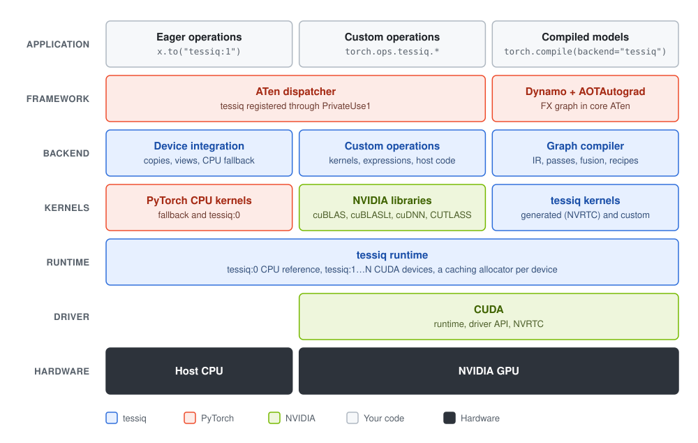

# tessiq

tessiq is an out-of-tree PyTorch backend for NVIDIA GPUs. It brings together the three pieces an
accelerator needs to run PyTorch models:

- **A device runtime.** It is registered as the `tessiq` device through PyTorch's PrivateUse1
  extension point.
- **A graph compiler.** It serves `torch.compile(model, backend="tessiq")`.
- **A kernel library.** It holds generated CUDA kernels, cuBLAS, cuDNN, and custom operations
  written with CUDA, CUTLASS or cuBLASLt.

It is for developers building or studying accelerator backends. Every layer, from ATen dispatch
down to the kernel launch, is in this repository. `tessiq.explain` and `tessiq-opt` show what each
layer does, and custom operations and compiler passes extend it without changes elsewhere.

> [!NOTE]
> tessiq is under active development (version 0.0.1). It builds from source on Linux and is tested
> on an NVIDIA RTX 5080.

## Architecture



Each column is one way into tessiq, read top to bottom:

- **Eager operations** on `tessiq` tensors go through ATen dispatch. Allocation, copies, views
  and `clone` have device implementations, and on a GPU so does everything in
  [`ops.toml`](ops.toml): elementwise operations and reductions run generated kernels, matmuls call
  cuBLAS and convolution calls cuDNN. Eval-mode batch norm and layer norm are built from those.
  Every other operation runs through the CPU fallback: the inputs are copied to the host, PyTorch
  computes the result, and it is copied back.
- **Custom operations** called as `torch.ops.tessiq.<name>` run their own kernels on the device.
- **Compiled models** are where the operations in `ops.toml` run on the device. `torch.compile`
  hands the graph compiler an FX graph, which it turns into a recipe:
  - elementwise chains are fused into generated kernels;
  - reductions get kernels of their own;
  - matmuls and convolutions call cuBLAS and cuDNN;
  - rewrite passes can substitute custom operations.

## Table of contents

- [Features](#features)
- [Components](#components)
- [Supported hardware and software](#supported-hardware-and-software)
- [Building from source](#building-from-source)
- [Quick start](#quick-start)
- [Configuration](#configuration)
- [Performance](#performance)
- [Limitations](#limitations)
- [Running tests](#running-tests)
- [Documentation](#documentation)

## Features

- `torch.compile(model, backend="tessiq")` for inference and training, including backward graphs
  and symbolic shapes.
- Elementwise chains fused into one generated CUDA kernel, compiled at run time for the GPU in use
  and cached on disk.
- Matrix multiplies through cuBLAS and convolutions through cuDNN.
- A `tessiq` device with a caching allocator per GPU. It works with `torch.accelerator`, pinned
  memory and `torch.save`/`torch.load`, and every ATen operation has a CPU fallback.
- Custom operations, one directory each. Each can be called directly, replace a PyTorch
  operation, or be rewritten into compiled models in place of the operations it computes.
- Tools that show what the compiler did: `tessiq.explain`, `tessiq.profile` and `tessiq-opt`.

## Components

**Device integration** (`csrc/tessiq/torch/`, `python/tessiq/device.py`)
- Registers `tessiq` with PyTorch: the device guard, the PrivateUse1 hooks, and the ATen kernels
  for allocation, copies, views and `clone`.
- Registers kernels for the operations in `ops.toml`. On a GPU tensor an elementwise operation or
  a reduction runs one kernel from the compiler's emitter, compiled once and cached, and a matmul
  or convolution is one cuBLAS or cuDNN call.
- Any other ATen operation on a `tessiq` tensor copies its inputs to the host, runs PyTorch's CPU
  kernel, and copies the result back.

**Graph compiler** (`csrc/tessiq/ir/`, `csrc/tessiq/passes/`, `python/tessiq/`)
1. Imports the FX graph from `torch.compile` into an SSA IR with a textual form.
2. Runs a pass pipeline that marks what the device can run, groups it into clusters and fuses
   elementwise chains. [docs/passes.md](docs/passes.md) describes the pipeline.
3. Plans one memory arena for the intermediates.
4. Produces a recipe, which is cached. An executor runs the recipe on each call.

**Custom operations** (`csrc/custom_ops/`)
- Each operation has a schema, an ATen reference, and one of three implementations: a CUDA kernel
  compiled with NVRTC, an elementwise expression the compiler fuses, or host code built with nvcc.
- Operations appear as `torch.ops.tessiq.<name>`.
  [csrc/custom_ops/README.md](csrc/custom_ops/README.md) explains how to add one.

**Kernels** (`csrc/tessiq/codegen/`)
- Generates CUDA C++ for fused elementwise loops, reductions and the pack kernel. NVRTC compiles it,
  and the cubins are cached on disk.
- Calls cuBLAS and cuDNN.
- Launches everything through one `Kernel` interface, with an explicit stream.

**Runtime** (`csrc/tessiq/runtime/`)
- A `Device` interface with two backends: the CPU reference (`tessiq:0`) and CUDA (`tessiq:1`
  onwards).
- A caching allocator per device, and copies between host and device.

## Supported hardware and software

| | |
|---|---|
| OS | Linux, x86-64 |
| GPU | An NVIDIA GPU supported by CUDA 12. Tested on an RTX 5080 (compute capability 12.0) |
| Python | 3.10 or later |
| PyTorch | 2.11, CUDA 12.8 build |
| CUDA Toolkit | 12.x, tested with 12.8. `nvcc` is only needed for the precompiled custom operations |
| cuDNN | 9.x, from PyTorch's `nvidia-cudnn-cu12` package. Without it, convolution runs on the host |
| CMake | 3.26 or later |
| C++ compiler | GCC with C++20 support. 11 and 13 are tested |

Without the CUDA Toolkit, tessiq builds with only the CPU reference device.

## Building from source

### Setup

```bash
git clone https://github.com/Logeswaran123/tessiq.git
cd tessiq
pip install torch==2.11.0 --index-url https://download.pytorch.org/whl/cu128
pip install -r requirements-dev.txt        # build, test and lint tools
pip install -e . --no-build-isolation      # builds the C++/CUDA extension
```

> [!IMPORTANT]
> Keep `--no-build-isolation`. The extension is compiled against the PyTorch you installed in the
> previous step.

### Verify

```console
$ python -c "import tessiq; print(tessiq.__version__, tessiq.gpu_count())"
0.0.1 1
```

A GPU count of 0 means the CUDA backend was not built, usually because CMake did not find the
toolkit. `pip install -v` prints the configuration summary, which then shows
`cuda backend ....... OFF`. Point CMake at the toolkit and rebuild:

```bash
pip install -e . --no-build-isolation -Ccmake.define.CUDAToolkit_ROOT=/usr/local/cuda
```

### Configuration flags

Pass flags with `-Ccmake.define.<FLAG>=<value>`:

| Flag | Default | |
|---|---|---|
| `TESSIQ_ENABLE_CUDA` | ON if the toolkit is found | Build the CUDA backend |
| `CMAKE_CUDA_ARCHITECTURES` | `native` | GPUs to build the precompiled custom operations for, such as `"89;120"` |
| `FETCHCONTENT_SOURCE_DIR_CUTLASS` | unset | Use a local CUTLASS checkout instead of downloading CUTLASS 4.8.0 |
| `TESSIQ_WARNINGS_AS_ERRORS` | ON | Treat compiler warnings as errors |
| `TESSIQ_SANITIZER` | empty | Sanitizers to build with, such as `address,undefined` |

## Quick start

### Compile a model

```python
import torch
import tessiq

model = torch.nn.Sequential(torch.nn.Linear(16, 32), torch.nn.GELU(), torch.nn.Linear(32, 4))
compiled = torch.compile(model, backend="tessiq", options={"device": "tessiq:1"})

batch = torch.randn(8, 16)
torch.testing.assert_close(compiled(batch), model(batch))
```

Always pass `options={"device": ...}`. Without it, the model compiles for `tessiq:0`, the CPU
reference device. That is useful for checking results but generates no GPU kernels.

- **Inputs** can be ordinary CPU tensors or tessiq tensors. Weights and other inputs that have not
  changed since the previous call stay on the device.
- **Results** are returned as CPU tensors.
- **Training** works the same way; the backward pass is compiled too.

`backend="tessiq"` also works without `import tessiq`, because the backend is registered as a
`torch_dynamo_backends` entry point.

### See how a model was compiled

`tessiq.explain` shows what the compiler did with a model:

```python
print(tessiq.explain(model, batch, device=tessiq.gpu))
```

```
== summary ==

model           Sequential on tessiq:1
shapes          known
operations      5
on the device   5
kernels         3, covering 3 operation(s)
...
== schedule ==

  permute       aten.permute.default     interpreted on the device (moves its inputs)
  addmm         aten.addmm.default       kernel %addmm (moves its inputs)
  gelu          aten.gelu.default        kernel %gelu
  permute_1     aten.permute.default     interpreted on the device (moves its inputs)
  addmm_1       aten.addmm.default       kernel %addmm_1 (moves its inputs)
```

The report also shows the imported graph, what each pass changed, and each kernel. Every operation
is placed one of three ways:

| Placement | Meaning |
|---|---|
| `kernel` | It runs in a kernel |
| `interpreted on the device` | It has no kernel, but runs on device tensors. A view moves no data |
| `host` | It runs on the CPU, with a copy each way |

### Work with tensors on the device

```python
x = torch.randn(1024, device=tessiq.gpu)  # same as device="tessiq:1"
y = x.to(tessiq.cpu)  # the CPU reference device, tessiq:0
z = x.cpu()  # an ordinary CPU tensor

tessiq.memory_stats(tessiq.gpu).allocated_bytes
torch.accelerator.memory_allocated(tessiq.gpu)
```

PyTorch gives an out-of-tree backend a single device type, so tessiq tells CPU and GPU apart by
index:

| Device | Python name | Backed by |
|---|---|---|
| `tessiq:0` | `tessiq.cpu` | Host memory. The reference implementation GPU results are tested against |
| `tessiq:1` | `tessiq.gpu`, `tessiq.gpu_at(0)` | The first CUDA GPU |
| `tessiq:2`, ... | `tessiq.gpu_at(1)`, ... | Further GPUs |

`device="tessiq"` without an index means the current tessiq device, which is `tessiq:0` until you
call `tessiq.set_device(tessiq.gpu)`.

### Use custom operations

tessiq ships custom operations under `torch.ops.tessiq`. You can call them directly:

```python
x = torch.randn(8, 64, device=tessiq.gpu)
weight = torch.randn(64, device=tessiq.gpu)
torch.ops.tessiq.rms_norm(x, weight, 1e-6)
```

Some also have a rewrite, which finds the same computation written in plain PyTorch and replaces
it. Rewrites change numerics slightly, so you opt in per compile:

```python
compiled = torch.compile(
    model, backend="tessiq", options={"device": "tessiq:1", "rewrites": ["gemm_bias_gelu"]}
)
```

For the model above, this turns the first `Linear` and the `GELU` into a single CUTLASS kernel.

| Operation | What it is | Rewrite matches |
|---|---|---|
| `rms_norm` | RMSNorm in one kernel | RMSNorm written out |
| `softmax` | Softmax kernel. Replaces PyTorch's float32 softmax on tessiq devices, no rewrite needed | |
| `fast_gelu` | Sigmoid-approximated GELU, fused with neighbouring operations | `x * sigmoid(1.702 * x)` |
| `swiglu` | `silu(gate) * up`, fused with neighbouring operations | |
| `layer_norm` | Layer norm in two kernels | |
| `gemm_bias_gelu` | CUTLASS GEMM with the bias and GELU fused into it | `Linear` then `GELU` |
| `gemm_bias_gelu_tanh` | cuBLASLt GEMM with the bias and tanh GELU fused into it | `Linear` then `GELU(approximate="tanh")` |

`tessiq.library.registered()` lists them, and `tessiq.library.rewrites()` lists the rewrites.
[`csrc/custom_ops/README.md`](csrc/custom_ops/README.md) explains how to add your own.

## Configuration

Options to `torch.compile(..., options={...})`:

| Option | Default | |
|---|---|---|
| `device` | `"tessiq:0"` | The tessiq device to compile for |
| `rewrites` | none | Custom operations whose rewrites to run, such as `["rms_norm"]` |

Environment variables:

| Variable | Default | |
|---|---|---|
| `TESSIQ_LOG_LEVEL` | `warn` | `error`, `warn`, `info`, `debug` or `trace` |
| `TESSIQ_LOG_MODULES` | all | Comma-separated modules to log, such as `passes,custom_ops` |
| `TESSIQ_CACHE_DIR` | `~/.cache/tessiq/cubin` | Where compiled kernels are cached |

## Performance

These were measured on an RTX 5080 with PyTorch 2.11, and each is a median. The scripts are in
[`bench/`](bench/).

**One fused kernel.** `(a * b + c).relu().sigmoid()` on 4M floats, with the data already on the
GPU, runs as a single tessiq kernel. It is faster than Inductor's
([`against_torch.py`](bench/against_torch.py)):

| | Time | Bandwidth |
|---|---|---|
| tessiq | 0.057 ms | 1101 GB/s |
| `torch.compile` (Inductor) | 0.072 ms | 874 GB/s |

**Linear + GELU.** GPU time for the three ways tessiq can run it
([`gemm_bias_gelu.py`](bench/gemm_bias_gelu.py)). The cuBLASLt version computes the tanh
approximation of GELU; the others compute the exact one.

| m × k → n | cuBLAS, then a GELU kernel | CUTLASS `gemm_bias_gelu` | cuBLASLt `gemm_bias_gelu_tanh` |
|---|---|---|---|
| 512 × 768 → 3072 | 114 µs | 126 µs | 103 µs |
| 4096 × 1024 → 4096 | 1369 µs | 1204 µs | 1236 µs |
| 8192 × 768 → 3072 | 1772 µs | 1840 µs | 1580 µs |
| 64 × 4096 → 4096 | 104 µs | 113 µs | 97 µs |

**A whole model block.** A transformer encoder block (512 wide, 128 steps, batch 8), called with
its input on the host ([`against_torch.py`](bench/against_torch.py)):

| | Time per call |
|---|---|
| tessiq | 1.14 ms |
| PyTorch eager, GPU | 0.88 ms |
| PyTorch eager, GPU, input already on the GPU | 0.53 ms |
| `torch.compile` (Inductor), input already on the GPU | 0.48 ms |
| PyTorch eager, CPU | 8.83 ms |

End to end, tessiq is behind PyTorch on the GPU, and most of a call is spent on the host
([`where_the_time_goes.py`](bench/where_the_time_goes.py)):

| Share of a call | |
|---|---|
| 42% | Steps without a kernel (views, permutes, clones), run one at a time through PyTorch's dispatcher |
| 34% | Launching the 25 kernels |
| 24% | Copying the result back to the host |

## Limitations

- **CUDA autograd in the same process.** Importing tessiq makes it PyTorch's accelerator, and
  `backward()` on ordinary CUDA tensors then fails in the same process. See
  [design note 0003](docs/design_notes/0003-one-accelerator-per-process.md).
- **Results come back to the host.** Compiled calls always return CPU tensors, so a large output
  pays a device-to-host copy on every call.
- **Eager coverage.** Outside `torch.compile`, an operation that is not in `ops.toml` and is not
  eval-mode batch norm or layer norm goes through the CPU fallback on tessiq tensors, a copy to the
  host and back per call.
- **Data types.** Generated kernels support float32, float64, int32 and int64. cuBLAS, cuDNN and
  most custom operations are float32 only, and other types run on the host.
- **Custom operations.** They have no backward pass yet, and their schemas can't have default
  arguments.
- **Random numbers.** Random operations run on the host.

## Running tests

```bash
pytest                    # Python tests; add -m "not cuda" on a machine without a GPU
```

The C++ core (IR, passes, runtime) builds and tests without PyTorch:

```bash
cmake -S . -B build -G Ninja -DTESSIQ_BUILD_PYTHON=OFF
cmake --build build
ctest --test-dir build
```

[CONTRIBUTING.md](CONTRIBUTING.md) covers the development setup, the checks CI runs, and code
conventions.

## Documentation

| | |
|---|---|
| [csrc/custom_ops/README.md](csrc/custom_ops/README.md) | Writing custom operations |
| [docs/passes.md](docs/passes.md) | The compiler's pass pipeline, and adding a pass |
| [docs/op_coverage.md](docs/op_coverage.md) | The operations the compiler supports |
| [docs/design_notes/](docs/design_notes/) | Design decisions |
| [tools/README.md](tools/README.md) | `tessiq-opt`, `tessiq_explain.py`, `model_coverage.py` |
| [bench/README.md](bench/README.md) | Benchmarks |
| [ROADMAP.md](ROADMAP.md) | What is done and what is planned |

## License

Apache 2.0. See [LICENSE](LICENSE).
